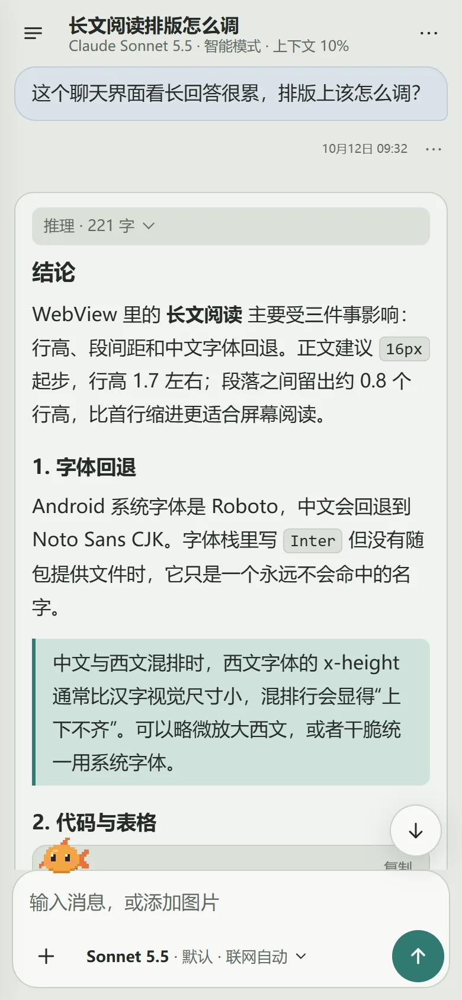
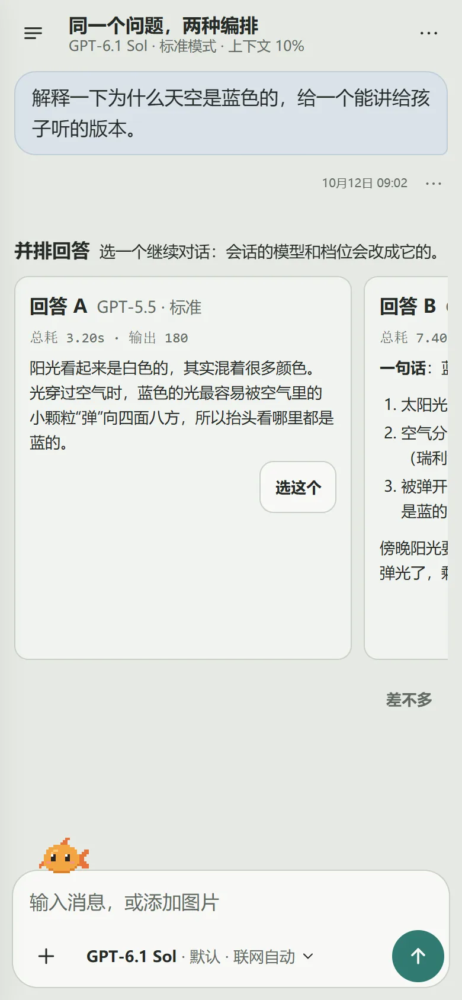
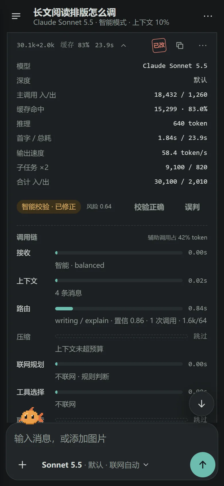

# Moyu Chat

> **English.** Moyu Chat is a personal Android multi-model chat client and model test bench: a native Java shell (protocol adapters for OpenAI Chat Completions / Responses and Anthropic Messages, SQLite sessions, context management, bounded web tools, verification) with a dependency-free WebView frontend. It is used to compare models, protocols and orchestration modes in everyday chats. The main features work on the author's device, but no APK or release is published; build from source if you want to try it.

Android 本地的多模型聊天客户端：原生 Java 外壳负责协议适配、SQLite 会话、上下文管理、联网工具、同模型子任务和智能校验，前端是无依赖的 WebView，只负责渲染视图模型。

它也是自用的模型实验台：对比不同模型、不同协议的输出，以及不同原生编排设计的效果。原生层的复杂度是有意为之。

<p>
  
  
  
</p>

对话 · 并排回答（模型 × 档位）· 每个回合的用量和调用链。截图来自浏览器预览的示例数据，手机宽度。

当前版本：**v0.0.6**（Android versionCode 6，SQLite 布局版本 1，库文件 `moyu-chat.db`，applicationId `com.moyu.chat`）。0.0.x 期间数据库不迁移，布局一变就清空重建。更新记录见 `CHANGELOG.md`。

## 现状

主要功能在作者的手机上日常使用正常。没有发布 APK 或 GitHub Release：目前的实机测试覆盖的情况还不够，达不到内测的标准；开启混淆的 release 包也还没在真机上跑过。想试用请从源码构建（见下文）。这是个人项目，不提供支持。

## 主要功能

- **三种档位**：极简 / 标准 / 智能，对应“编排帮多少忙”，切换后就能对比同一模型在不同档位下的表现和成本。
- **并排回答**：同一个问题同时发给 2–3 路“模型 × 档位”，回答是同一提问的不同版本；选一路继续，或判“差不多”；可选盲评。
- **调用链**：每个回合逐阶段记录状态、耗时、token 和判断，跳过的阶段写明原因；协议检查器保留脱敏后的请求和响应原文。
- **辅助模块**：路由、压缩、原文回查、联网规划、跨会话检索、校验修正、子任务都能单独关闭，可以指定单独的辅助模型。
- **统计**：按模型、协议、深度、档位汇总延迟、token、花费、辅助占比、评价和并排胜负。
- **消息树**：重答、编辑、切换版本都在同一会话里进行；分支会话从源会话的快照开始，不改动源会话。

## 构建与验证

```bash
npm run verify
```

这会先跑前端静态检查（`npm run build`）和前端测试，再跑 `:app:testDebugUnitTest :app:lintDebug :app:assembleDebug`。前端源码在 `src/` 和 `index.html`；`android/app/src/main/assets/ui/` 是构建时同步生成的副本。

构建工具不在仓库里（`.tools/` 被 Git 忽略，也没有 Gradle Wrapper）。第一次构建前需要自己准备：

- Node.js（前端检查和测试只用它自带的模块）；
- Gradle 8.5，解压到 `.tools/gradle-8.5/`（`scripts/verify.sh` 调用 `.tools/gradle-8.5/bin/gradle`）；
- JDK 17，解压到 `.tools/jdk-17*`（存在时用作 `JAVA_HOME`；没有时系统的 `JAVA_HOME` 必须是 JDK 17）；
- Android SDK，通过 `ANDROID_HOME` 或 `android/local.properties` 指定。

### Release APK

release 包开启 R8 压缩，用不进仓库的本机密钥签名。在仓库外生成一次密钥：

```bash
keytool -genkeypair -v -keystore ~/moyu-release.jks -alias moyu -keyalg RSA -keysize 4096 -validity 10000
```

然后写好 `android/app/keystore.properties`（Git 忽略）：

```properties
storeFile=C:/Users/you/moyu-release.jks
storePassword=...
keyAlias=moyu
keyPassword=...
```

之后运行 `bash scripts/verify.sh :app:assembleRelease`，会另外生成 `android/app/build/outputs/apk/release/app-release.apk`。没有这个配置文件时，release 包不签名。release 签名的包不能覆盖 debug 签名的安装，需要先卸载一次（本地数据会清空）。

## 产品边界

- 会话和可见历史归 Moyu Chat 所有，存在它自己的数据库里。
- API Key 只存在 Android 原生安全存储中，不进 WebView，也不进 SQLite。
- 分支会话从源会话可见历史的不可变快照开始，分支永远不改动源会话。
- 服务商私有的推理、thinking 和续接状态是派生的协议状态，不作为持久的事实来源。
- 具体部署明确声明支持对应的客户端工具协议时，运行时提供有界的客户端工具：`web_search`、`web_fetch`、隔离的同模型子任务 `delegate_subtask`、本会话原文回查 `history_recall` 和跨会话检索 `conversation_search`。
- Moyu Chat 不是 Android 上的 agent 运行时：不提供 shell、computer use、任意文件修改、设备控制、递归子任务或自主的后台任务循环。

## 账号、路线、模型与会话

“协议 ≠ 能力”是硬约束。详见 `docs/provider-config.md`。

- **账号**：一个 API Key（只在原生安全存储里）、它的状态，以及可选的每日 / 每月预算。
- **路线**：账号的一个端点，包括协议、Base URL、认证方式、协议细节（含可选的并发上限）和非机密的附加请求头。Key 只发往账号已确认的域名，不跟随重定向。
- **Model Profile**：路线上的一个具体部署。每项能力逐项合成，优先级为 默认 < 端点（端点自己的模型列表）< 目录（审核过的预设）< 实测 < 手动，并显示每个值的来源。
- **会话**：创建或切换模型时冻结当时合成的部署。之后修改 Profile 不会改动已有会话的标注，会话会提示是否应用修改后的配置。

支持的协议族是 `openai-chat-completions`、`openai-responses` 和 `anthropic-messages`，它们只决定请求和响应的格式。

## 上下文档位与 Harness

- **极简**：最薄的原生聊天基线，保留最近的完整回合。没有记忆 / 检索、压缩、路由、校验、子任务，也不使用服务商私有续接。放不下时只截断最早的回合。
- **标准**：日常使用的上下文管理：可选的全局记忆 / 检索、快照检索、压缩，以及显式开启的服务商续接。可靠性提示模块由冻结的 `lean / balanced / reinforced` Harness 预设决定。子任务可选，默认关闭。
- **智能**：在标准档基础上，按 Harness 策略加入路由、证据策略和校验修正。路由默认关闭，可以在辅助模块里打开。子任务默认“自动”，简单任务可以一次也不调用。

子任务是隔离的同模型调用，不是设备上的 agent。最多同时 4 个，只有一层，子任务拿到的是有界的任务上下文，不能再发起客户端工具循环。

标准、智能档的历史尽量保留原文，接近上限时才压缩：

- **工具结果清除**：带上全部工具结果后超过可用输入的 50% 时，从最旧的工具结果开始替换为占位文字，至少保留最近 3 次。库里保存的结果不变。
- **压缩**：回合结束后按实际用量判断，超过可用输入的 75% 就在后台压缩。除最近 2 轮以外的历史总结成自然语言摘要，放在消息最前。下一回合放得下就不等它，放不下才等。
- **截断**：压缩后仍放不下或压缩失败时，才截断最早的原文回合，作为最后手段。

提示词预算从不删除库里的历史。

## 客户端工具与同一回合的协议状态

一个用户回合里，客户端工具每批最多 8 次调用，最多 4 轮工具往返；原文回查和跨会话检索各自每回合最多 3 次。

工具定义、累积的工具调用和结果，以及服务商的轮次状态都计入输入预算。之后的轮次可以省略较早的普通回合来腾出空间。已经发出的工具结果和服务商的推理 / thinking 状态不会被改写，只有新产生、还没发出的工具结果可以裁剪。必需的工具和协议状态仍放不下时，回合明确失败，不会发出超出上下文的请求。

OpenAI Responses 在同一回合里重放 `function_call_output` 之前需要的输出项；Anthropic Messages 重放 `tool_result` 之前对应的 thinking / redacted-thinking / tool-use 内容块。这种同一回合的协议历史，和可选的跨回合服务商私有续接是两回事。

## 联网

明确声明了服务商原生联网时优先用它。否则，明确支持客户端工具的部署可以用 Moyu 的 `web_search` / `web_fetch`；不支持客户端工具的部署仍可用有界的 Moyu 主机检索兜底。

联网模式和极简 / 标准 / 智能档相互独立。联网“开启”或消息里带网址时，即使有客户端工具也可能触发有界的主机检索；支持时仍优先用服务商联网。语义规划本身可能发起一次辅助模型请求。

Responses 目前支持的通用服务商联网能力是 `web_search`。Messages 需要明确声明支持的 Anthropic 协议版本，例如 `web_search_20260209` 或 `web_fetch_20250910`；通用别名不会被转换成 Messages 的格式。

兜底检索和抓取的材料是临时的不可信上下文，不会作为用户写的内容进入时间线。

## 端点根地址

Base URL 按各协议官方 SDK 的写法填写，传输层负责追加路径：

- Chat Completions / Responses：根地址包含版本段（`https://api.openai.com/v1`），追加 `/chat/completions` 或 `/responses`。
- Messages：根地址不带 `/v1`（`https://api.anthropic.com`），追加 `/v1/messages`。

## 用量与本地图片限制

回合用量包括主调用、辅助调用（路由、压缩、联网规划、校验 / 修正、会话命名）和子任务。辅助调用失败、超时或被取消时，服务商报告的用量仍会保留。没报用量的保持未知，只有部分数据的合计会标明。花费按 Model Profile 声明的价格估算（回合开始时冻结），不含服务商联网工具的费用；指定了辅助模型时，它的花费按它自己的价格计入它的账号。

调用次数指逻辑上的传输调用：Anthropic 内部的 `pause_turn` HTTP 续接属于同一次调用，用量累加在一起。这些计数不是账单，也不是原始 HTTP 请求数。

图片输入和输出的上限是编码后 12 MiB、16,777,216 像素、单边 8,192 像素；草稿最多 4 张图片。超限的图片在写入私有媒体文件之前就会被拒绝。

`docs/history/` 保留 v0.0.1–v0.0.5 的设计和审查基线。当前版本以本 README、`ARCHITECTURE.md`、`CLAUDE.md` 和源码为准。

## Git 历史

`v0.0.5` 及之前的提交来自 Codex 时期，大部分是工具在每次修改和构建前后自动打的快照（`pre-change checkpoint`、`post-build …`），提交说明看不出意图；这段时期请看打了 tag 的版本和 `docs/history/`。从 `v0.0.5` 起，每个提交对应一个经过验证的阶段：`git log v0.0.5..main`。
